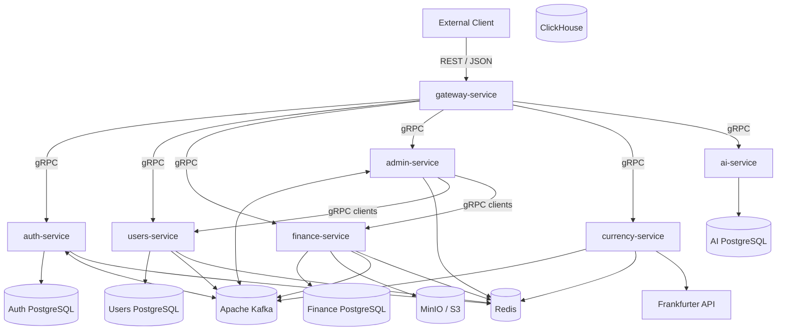

# Finance Microservices

Микросервисная платформа для учёта личных финансов, построенная на Go. Система разделена на независимые сервисы с собственными зонами ответственности. Внешние HTTP-запросы принимает `gateway-service`, который преобразует REST/JSON-запросы в gRPC-вызовы. Для синхронного взаимодействия между сервисами используется gRPC, для асинхронного обмена событиями — Apache Kafka.

Репозиторий организован как Go multi-module monorepo: каждый микросервис имеет собственный `go.mod`, Dockerfile и запускается отдельным процессом.

## Содержание

- [Возможности](#возможности)
- [Технологический стек](#технологический-стек)
- [Архитектура](#архитектура)
- [Микросервисы](#микросервисы)
- [Межсервисное взаимодействие](#межсервисное-взаимодействие)
- [Инфраструктура](#инфраструктура)
- [Наблюдаемость](#наблюдаемость)
- [Структура микросервиса](#структура-микросервиса)
- [Порты](#порты)
- [Переменные окружения](#переменные-окружения)
- [Запуск](#запуск)
- [Полезные команды](#полезные-команды)

## Возможности

- Регистрация, аутентификация и авторизация пользователей с использованием JWT.
- Управление профилями пользователей и ролями `user` / `admin`.
- Учёт финансовых операций: доходов и расходов.
- Получение сводной статистики и данных для финансового дашборда.
- Управление категориями транзакций.
- Экспорт финансовых отчётов в JSON, CSV, TXT и PDF.
- Хранение экспортированных файлов в S3-совместимом хранилище MinIO.
- Конвертация сумм между валютами и пересчёт транзакций в USD.
- Административное управление пользователями и агрегированной статистикой.
- Распределённое удаление пользовательских данных с использованием Saga.
- Асинхронное обновление read-моделей через Kafka.

## Технологический стек

| Область | Технологии |
|---|---|
| Язык | Go 1.26.4 |
| Межсервисное взаимодействие | gRPC, Protocol Buffers |
| Внешний API | REST/JSON, gRPC-Gateway |
| Брокер сообщений | Apache Kafka, `segmentio/kafka-go` |
| Основные БД | PostgreSQL 15 |
| Кэш и read-модели | Redis 7 |
| Объектное хранилище | MinIO, S3 API |
| Контейнеризация | Docker, Docker Compose |
| Аутентификация | JWT, bcrypt |
| Метрики | Prometheus |
| Трейсинг | OpenTelemetry, Jaeger |
| Логирование | Zap |
| API-документация | Swagger / OpenAPI |
| Тестирование | Testify, mocks |
| Миграции | golang-migrate |
| Внешний API курсов валют | Frankfurter API |
| CI/CD | GitHub Actions |

## Архитектура

Клиент обращается к системе через `gateway-service` по HTTP. Gateway проверяет JWT и перенаправляет запросы в соответствующие доменные сервисы по gRPC.

В системе выделены следующие микросервисы:

1. `gateway-service` — единая внешняя точка входа.
2. `auth-service` — регистрация, аутентификация и учётные данные.
3. `users-service` — профили пользователей и роли.
4. `finance-service` — финансовые операции и отчёты.
5. `admin-service` — административные операции и системная статистика.
6. `currency-service` — курсы валют и конвертация.
7. `ai-service` — отдельный сервис AI-обработки запросов с интеграцией Groq API.

### Основные архитектурные решения

- **Database per Service.** `auth-service`, `users-service` и `finance-service` используют отдельные PostgreSQL-базы. Сервисы не обращаются напрямую к чужим таблицам.
- **Синхронное взаимодействие.** Для запросов между сервисами используется gRPC.
- **Асинхронное взаимодействие.** События предметной области передаются через Kafka.
- **CQRS / Read Model.** `admin-service` и `currency-service` поддерживают собственные представления данных, обновляемые на основе событий и сохраняемые в Redis.
- **Saga.** Для удаления пользователя используется оркестрируемая сага с компенсирующим действием.
- **Observability.** Сервисы экспортируют метрики, формируют распределённые трейсы и пишут структурированные логи.

### Схема взаимодействия



## Микросервисы

### gateway-service

Единая точка входа для внешних клиентов. HTTP-сервер построен на `grpc-gateway`: REST-маршруты формируются на основе аннотаций в `.proto`-файлах, а запросы преобразуются в gRPC-вызовы.

Основные задачи:

- Маршрутизация запросов в `auth`, `users`, `finance`, `admin` и `currency`.
- Проверка JWT из заголовка `Authorization: Bearer` или cookie `token`.
- Пропуск публичных маршрутов: healthcheck, метрики, Swagger, регистрация, вход и выход.
- Передача `Authorization` в gRPC metadata.
- Выдача Swagger UI и OpenAPI-спецификации.
- Предоставление endpoint для скачивания экспортированных файлов из MinIO.
- Экспорт метрик Prometheus и endpoint `/healthz`.

Middleware-цепочка: CORS → Auth → RequestID → Logger → OpenTelemetry Trace → Panic Recovery.

### auth-service

Отвечает за аутентификацию и хранение учётных данных пользователя. Email и bcrypt-хэш пароля хранятся отдельно от пользовательского профиля.

Основные операции:

- `Register` — создаёт учётные данные, вызывает `users-service.CreateProfile`, после успешного создания профиля активирует credential и выдаёт JWT.
- `Login` — проверяет пароль и выдаёт JWT.
- `Logout` — завершает пользовательскую сессию согласно реализации сервиса.

Хранилища и интеграции:

- Собственная PostgreSQL-база с таблицей `credentials`.
- Статусы учётной записи: `pending`, `active`, `failed`.
- Redis для кэша / сессионных данных.
- Kafka для публикации и получения событий.
- JWT на базе `golang-jwt/jwt`.

### users-service

Источник истины о пользовательских профилях. Хранит email, имя, телефон и роль пользователя (`user` или `admin`).

Основные gRPC-операции:

- `GetUser`, `GetUserByEmail`, `ListUsers`.
- `CreateProfile`, `PatchUser`, `DeleteUser`.
- `UpdateRole`, `AdminExists`.
- `GetMetrics`.
- `MarkDeleting`, `RestoreUser`, `FinalizeDelete` — операции жизненного цикла пользователя для саги удаления.

Хранилища и интеграции:

- Собственная PostgreSQL-база и SQL-миграции.
- Redis-кэш профилей и списков пользователей.
- Публикация `user.created` и `user.deleted` в Kafka.
- gRPC-взаимодействие с другими сервисами.

### finance-service

Основной доменный сервис финансового учёта. Отвечает за транзакции, категории, сводную статистику и экспорт отчётов.

Основные gRPC-операции:

- `CreateTransaction`, `GetTransaction`, `GetTransactions`.
- `UpdateTransaction`, `DeleteTransaction`.
- `DeleteUserTransaction` — удаление всех транзакций пользователя в рамках саги.
- `GetDashboard` — агрегированная статистика доходов и расходов.
- `GetCategories`, `GetMetrics`.
- `ExportJSON`, `ExportCSV`, `ExportTXT`, `ExportPDF`.
- `DownloadExport` — получение ранее сформированного файла.

Хранилища и интеграции:

- Собственная PostgreSQL-база с транзакциями пользователей.
- Redis-кэш.
- MinIO используется для экспортированных отчётов, а не для хранения транзакционных данных.
- PDF-отчёты формируются с помощью `gofpdf`.
- S3 API используется через AWS SDK for Go v2.
- Публикует Kafka-события `transaction.created`, `transaction.updated`, `transaction.deleted`.

### admin-service

Сервис административных операций. Управляет пользователями, предоставляет агрегированную системную статистику и координирует удаление пользовательских данных в нескольких сервисах.

Основные gRPC-операции:

- `GetUsers` — получение списка пользователей через `users-service`.
- `GetUser` — получение данных пользователя через `users-service`.
- `DeleteUser` — запуск саги удаления пользователя.
- `UpdateUserRole` — изменение роли пользователя.
- `GetMetrics` — получение агрегированной статистики.

Хранилища и интеграции:

- Собственной PostgreSQL-базы нет.
- Redis используется для агрегированных метрик и кэширования read-модели.
- gRPC-клиенты для `users-service` и `finance-service`.
- Kafka consumer обрабатывает `transaction.created`, `transaction.updated`, `transaction.deleted`, `user.created`, `user.deleted`.
- Kafka producer публикует `admin.metrics` и событие завершения удаления транзакций пользователя.
- Метрики Prometheus экспортируются отдельно от gRPC-сервера.
- gRPC-сервер использует interceptors для Request ID, логирования, JWT-аутентификации, метрик и трейсинга.
- Поддерживается опциональная TLS-конфигурация для gRPC-соединений.

### ai-service

Отдельный микросервис для обработки AI-запросов. Сервис интегрируется с Groq API и изолирован от остальных доменов на уровне процесса и собственной PostgreSQL-базы. Известные точки подключения: HTTP `9099` и gRPC `50056`.

AI-функциональность вынесена в отдельный сервис, чтобы не смешивать интеграцию с внешней языковой моделью с бизнес-логикой финансовых сервисов. Конкретные gRPC-методы, HTTP-маршруты и структуру хранимых данных следует сверять с актуальными `.proto`-файлами и реализацией `ai-service`.

### currency-service

Сервис получения курсов валют и конвертации финансовых сумм. Используется для пересчёта транзакций в USD.

Основные gRPC-операции:

- `GetRates` — получение актуальных курсов.
- `Convert` — конвертация одной суммы.
- `ConvertBatch` — пакетная конвертация.
- `GetTransactionUSD` — получение суммы транзакции в USD.

Хранилища и интеграции:

- Собственной PostgreSQL-базы нет.
- Redis хранит курсы валют и рассчитанные суммы.
- Актуальные курсы загружаются из Frankfurter API: `https://api.frankfurter.app/latest`.
- Kafka consumer обрабатывает `transaction.created` и `transaction.deleted`, чтобы обновлять или инвалидировать USD read-model.

## Межсервисное взаимодействие

### Kafka

Сервисы используют общий топик `finance-events`. Kafka обеспечивает асинхронное распространение изменений между доменами и позволяет обновлять read-модели без синхронных запросов к исходному сервису.

| Событие | Producer | Consumers | Назначение |
|---|---|---|---|
| `transaction.created` | finance | admin, currency | Обновление статистики и суммы в USD |
| `transaction.updated` | finance | admin | Пересчёт агрегированной статистики |
| `transaction.deleted` | finance | admin, currency | Обновление статистики и USD read-model |
| `user.created` | users | admin | Обновление счётчиков пользователей |
| `user.deleted` | users | admin | Обновление счётчиков пользователей |
| `user.transactions.deleted` | finance | — | Сигнал о завершении шага саги удаления |
| `admin.metrics` | admin | — | Публикация обновлённых агрегированных метрик |

Для просмотра топиков, сообщений и consumer groups используется Kafka UI.

### Saga: удаление пользователя

Удаление пользователя затрагивает данные как минимум в `users-service` и `finance-service`. Для координации используется оркестрируемая Saga, оркестратор — `admin-service`.

Последовательность:

1. `admin-service` вызывает `users-service.MarkDeleting(id)`. Пользователь переводится в состояние удаления.
2. `admin-service` вызывает `finance-service.DeleteUserTransaction(id)` для удаления транзакций пользователя.
3. Если удаление транзакций завершается ошибкой, `admin-service` вызывает `users-service.RestoreUser(id)`. Это компенсирующее действие возвращает пользователя в рабочее состояние.
4. Если удаление транзакций прошло успешно, вызывается `users-service.FinalizeDelete(id)` для окончательного удаления пользователя.

Таким образом, вместо распределённой транзакции 2PC используются локальные операции и компенсация при ошибке. Шаги саги логируются и доступны для анализа через распределённый трейсинг.

### Регистрация пользователя

Регистрация в `auth-service` также состоит из последовательных локальных операций:

1. Создаётся credential со статусом `pending`.
2. Вызывается `users-service.CreateProfile`.
3. При успехе credential переводится в `active`, при ошибке — в `failed`.

## Инфраструктура

Инфраструктура описана в `docker-compose.yaml`. Компоненты запускаются в общей Docker bridge-сети `finance-net`.

| Компонент | Назначение |
|---|---|
| `auth-postgres` | База учётных данных |
| `users-postgres` | База пользовательских профилей |
| `finance-postgres` | База финансовых транзакций |
| `ai-postgres` | База данных AI-сервиса |
| `clickhouse` | Аналитическое хранилище / аналитические запросы |
| `finance-redis` | Общий кэш и read-модели |
| `kafka` | Брокер событий в режиме KRaft |
| `kafka-ui` | Веб-интерфейс Kafka |
| `minio` | S3-совместимое хранилище экспортов |
| `jaeger` | Сбор и просмотр трейсов |
| `prometheus` | Сбор метрик |
| `auth-postgres-migrate` | Миграции auth PostgreSQL |
| `users-postgres-migrate` | Миграции users PostgreSQL |
| `finance-postgres-migrate` | Миграции finance PostgreSQL |

PostgreSQL-базы изолированы и доступны сервисам внутри Docker-сети. Redis используется сервисами для кэширования и хранения read-моделей. Kafka работает в режиме KRaft без Zookeeper. MinIO предоставляет S3 API и отдельную веб-консоль.

## Наблюдаемость

- **Prometheus.** Каждый сервис экспортирует метрики на отдельном HTTP-порту через `/metrics`. Prometheus собирает метрики согласно `prometheus.yml`.
- **OpenTelemetry + Jaeger.** gRPC- и HTTP-вызовы инструментированы для распределённого трейсинга. Трейсы передаются по OTLP/gRPC.
- **Zap.** Структурированные логи. Путь и уровень логирования настраиваются переменными окружения.
- **Kafka UI.** Просмотр сообщений, топиков и consumer groups.
- **Swagger UI.** Интерактивная документация REST API gateway.
- **MinIO Console.** Просмотр экспортированных файлов.

## Структура микросервиса

В каждом Go-сервисе используется собственный модуль и отдельная точка входа. Общая структура по исходному устройству сервисов:

```text
<service>/
├── cmd/
│   └── <service>/
│       └── main.go
├── config/
├── internal/
│   ├── core/
│   │   ├── auth/
│   │   ├── cache/
│   │   ├── clients/
│   │   ├── grpc/
│   │   ├── kafka/
│   │   ├── metrics/
│   │   ├── ports/
│   │   └── telemetry/
│   └── features/
│       └── <domain>/
│           ├── service/
│           ├── repository/
│           └── transport/
├── migrations/
├── pkg/
├── proto/
├── Dockerfile
├── go.mod
└── go.sum
```

Назначение основных директорий:

- `cmd` — запуск приложения.
- `config` — конфигурация из переменных окружения.
- `internal/core` — инфраструктурные компоненты и адаптеры.
- `internal/features` — доменная бизнес-логика, репозитории и транспорт.
- `migrations` — SQL-миграции.
- `pkg` — переиспользуемые вспомогательные пакеты.
- `proto` — Protocol Buffers и сгенерированный gRPC-код.

## Порты

### Сервисы приложения

| Сервис | Протокол | Порт |
|---|---|---:|
| `gateway-service` | HTTP / REST | `8081` |
| `auth-service` | gRPC | `50051` |
| `users-service` | gRPC | `50052` |
| `finance-service` | gRPC | `50053` |
| `admin-service` | gRPC | `50054` |
| `currency-service` | gRPC | `50055` |
| `ai-service` | gRPC | `50056` |
| `ai-service` | HTTP | `9099` |

### Метрики

| Сервис | Порт |
|---|---:|
| `auth-service` | `9091` |
| `finance-service` | `9093` |
| `admin-service` | `9094` |
| `currency-service` | `9095` |
| `users-service` | `9096` |

### Инфраструктура

| Компонент | Порт |
|---|---:|
| Kafka | `9092` |
| Redis | `6379` |
| Kafka UI | `8080` |
| MinIO S3 API | `9000` |
| MinIO Console | `9001` |
| Prometheus | `9090` |
| Jaeger UI | `16686` |
| Jaeger OTLP gRPC | `4317` |

Фактические опубликованные порты и адреса зависят от конфигурации `docker-compose.yaml`. Для `ai-service` HTTP-порт `9099` и gRPC-порт `50056` указаны по текущей конфигурации проекта.

## Переменные окружения

Полный перечень переменных и примеры значений находятся в `env.example`. Перед запуском необходимо создать `.env` и заполнить обязательные секреты и адреса сервисов.

Основные группы:

| Переменная | Назначение |
|---|---|
| `POSTGRES_*` | Общие параметры PostgreSQL |
| `AUTH_POSTGRES_*` | Подключение auth-service к PostgreSQL |
| `USERS_POSTGRES_*` | Подключение users-service к PostgreSQL |
| `FINANCE_POSTGRES_*` | Подключение finance-service к PostgreSQL |
| `JWT_SECRET` | Секрет подписи JWT |
| `JWT_DURATION` | Срок действия JWT |
| `REDIS_ADDR` | Адрес Redis |
| `KAFKA_BROKERS` | Адреса Kafka broker |
| `S3_ENDPOINT_URL` | Endpoint MinIO / S3 |
| `S3_REGION` | Регион S3 |
| `S3_BUCKET` | Bucket для экспортированных файлов |
| `S3_ACCESS_KEY`, `S3_SECRET_KEY` | Учётные данные S3 |
| `MINIO_ROOT_USER`, `MINIO_ROOT_PASSWORD` | Учётные данные MinIO |
| `TLS_ENABLED` | Включение TLS для gRPC |
| `TLS_CERT_FILE`, `TLS_KEY_FILE`, `TLS_CA_FILE` | TLS-сертификаты |
| `LOGGER_LEVEL` | Уровень логирования |
| `LOGGER_FOLDER` | Директория логов |
| `TIME_ZONE` | Часовой пояс процессов |

Не добавляйте реальные пароли, токены, приватные ключи и другие секреты в репозиторий.

## Запуск

### Требования

- Go версии, указанной в `go.mod` сервисов.
- Docker и Docker Compose.
- Git.

### Запуск через Docker Compose

1. Клонируйте репозиторий:

   ```bash
   git clone <repository-url>
   cd finance-microservices
   ```

2. Создайте файл окружения:

   ```bash
   cp env.example .env
   ```

3. Заполните обязательные значения в `.env`.

4. Соберите и запустите инфраструктуру и сервисы:

   ```bash
   docker compose up -d --build
   ```

5. Проверьте состояние контейнеров:

   ```bash
   docker compose ps
   ```

6. При необходимости посмотрите логи:

   ```bash
   docker compose logs -f
   ```

### Доступные интерфейсы локального окружения

| Интерфейс | Адрес |
|---|---|
| REST API / Swagger | `http://localhost:8081/swagger/` |
| Kafka UI | `http://localhost:8080` |
| MinIO Console | `http://localhost:9001` |
| Jaeger | `http://localhost:16686` |
| Prometheus | `http://localhost:9090` |

Адреса приведены для локального запуска с настройками портов по умолчанию.

## Полезные команды

Команды доступны через `Makefile`:

| Команда | Назначение |
|---|---|
| `make up` | Запуск системы |
| `make down` | Остановка системы |
| `make migrate-up-all` | Применение миграций auth, users и finance |
| `make services-logs` | Просмотр логов доменных сервисов |
| `make kafka-ui` | Открытие Kafka UI |
| `make proto-gen-all` | Генерация protobuf/gRPC-кода |
| `make swagger-gen` | Генерация Swagger / OpenAPI |

## Тестирование

Для запуска тестов отдельного сервиса перейдите в его директорию и выполните:

```bash
go test ./...
```

Для проверки конкурентного доступа и поиска data race:

```bash
go test -race ./...
```

Для проверки сборки:

```bash
go build ./...
```

В проекте используются `testify` и моки для модульного тестирования. Наличие и покрытие конкретных тестов зависит от сервиса.

## CI/CD и развёртывание

В исходной конфигурации проекта использовался GitHub Actions: при push в `master` выполнялись проверки и тесты, после чего приложение обновлялось на сервере с помощью Docker Compose.

Ранее проект развёртывался на Timeweb Cloud. Указанный в предыдущей версии README срок оплаты хостинга истёк 05.09.2026, поэтому прежние публичные адреса и доступность сервера не считаются актуальными. Для нового развёртывания необходимо настроить собственный сервер, секреты GitHub Actions и параметры окружения.

---

<p align="center">
  Built with Go · gRPC · Kafka · PostgreSQL · Redis
</p>
